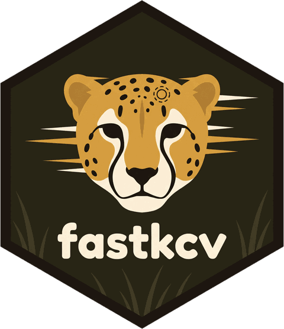

::::::: {.home-wrap}

<!-- ============ Hero ============ -->
:::::: {.hero}

::::: {.hero-text}

<!-- Job-market badge: remove the comment markers to show it.
[[<i class="bi bi-briefcase"></i> On the job market, 2026–27](files/cv.pdf)]{.pill}
-->

```{=html}
<h1 class="hero-title">Nicholas C. Taylor</h1>
```

[PhD Candidate in Statistics at [Baylor University]{.accent}]{.hero-tagline}

[I develop spatial and spatiotemporal statistical methods for water resources and the environment, with a focus on satellite remote sensing and fair evaluation of predictive models.]{.hero-summary}

:::: {.hero-actions}
[<i class="bi bi-file-earmark-pdf"></i> Download CV](files/cv.pdf){.btn-accent}
[<i class="bi bi-envelope"></i> Email me](mailto:nicholasclevelandtaylor@gmail.com){.btn-ghost}
::::

:::: {.hero-links}
[<i class="bi bi-github"></i>GitHub](https://github.com/n-c-taylor)
[<i class="bi bi-linkedin"></i>LinkedIn](https://www.linkedin.com/in/nicholas-c-taylor)
<!-- [<i class="bi bi-mortarboard"></i>Google Scholar](https://scholar.google.com/citations?user=XXXX) -->
<!-- [<i class="bi bi-person-badge"></i>ORCID](https://orcid.org/0000-0000-0000-0000) -->
::::

:::::

::::: {.hero-photo}
{fig-alt="Portrait of Nicholas C. Taylor"}
:::::

::::::

<!-- ============ Stat strip ============ -->
::::: {.stat-strip}
:::: {.stat}
[2]{.stat-num} [Manuscripts]{.stat-label}
::::
:::: {.stat}
[2]{.stat-num} [Conference talks]{.stat-label}
::::
:::: {.stat}
[3]{.stat-num} [Courses as instructor]{.stat-label}
::::
:::: {.stat}
[2027]{.stat-num} [PhD (expected)]{.stat-label}
::::
:::::

<!-- ============ About ============ -->
::: {.section-head}
[Background]{.eyebrow}

## About
:::

I am a fourth-year PhD candidate in the Department of Statistical Science at Baylor University, advised by [Dr. Amanda S. Hering](https://statistics.artsandsciences.baylor.edu/person/dr-amanda-s-hering). I am interested in spatial and spatiotemporal statistical modeling, predictive model validation, satellite remote sensing, and functional data analysis, with applications to water resources and the environmental and biological sciences. My work is motivated by applied problems, and I enjoy collaborative research that brings statistical methods to bear on real-world questions.

I am a Research Assistant with the Baylor Water Security Collaborative, where I am working to characterize public water data resources across Texas.

<!-- ============ News ============ -->
::: {.section-head}
[Updates]{.eyebrow}

## Recent news
:::

::: {#news}
:::

<!-- ============ Research interests ============ -->
::: {.section-head}
[What I work on]{.eyebrow}

## Research interests
:::

::::: {.card-grid}
:::: {.feature-card}
[<i class="bi bi-geo-alt"></i>]{.icon-box}
[Spatial and spatiotemporal statistics]{.card-title}
::::
:::: {.feature-card}
[<i class="bi bi-check2-circle"></i>]{.icon-box}
[Predictive model validation]{.card-title}
::::
:::: {.feature-card}
[<i class="bi bi-globe-americas"></i>]{.icon-box}
[Satellite remote sensing]{.card-title}
::::
:::: {.feature-card}
[<i class="bi bi-graph-up"></i>]{.icon-box}
[Functional data analysis]{.card-title}
::::
:::: {.feature-card}
[<i class="bi bi-droplet"></i>]{.icon-box}
[Water resources and the environmental sciences]{.card-title}
::::
:::::

<!-- ============ Featured software ============ -->
::: {.section-head}
[Open source]{.eyebrow}

## Featured software
:::

:::: {.teaser-card .software-teaser}
{.teaser-logo fig-alt="fastkcv hex logo"}

::: {.teaser-text}
[<i class="bi bi-code-slash"></i> R package]{.pill}

**fastkcv**: fast, exact cross-validation for global kriging, as a companion to gstat. [Up to 1,500× faster leave-one-out CV than gstat::krige.cv().]{.teaser-stat}
:::
[View software <i class="bi bi-arrow-right"></i>](software.qmd){.btn-ghost}
::::

<!-- ============ Education ============ -->
::: {.section-head}
[Degrees]{.eyebrow}

## Education
:::

::::::: {.timeline}

:::: {.cv-entry}
::: {.cv-what}
**PhD, Statistics**\
*Baylor University*
:::
::: {.cv-when}
Expected 2027
:::
::::

:::: {.cv-entry}
::: {.cv-what}
**MS, Statistics**\
*Baylor University*
:::
::: {.cv-when}
2025
:::
::::

:::: {.cv-entry}
::: {.cv-what}
**MS, Mathematics**\
*Texas Tech University*
:::
::: {.cv-when}
2023
:::
::::

:::: {.cv-entry}
::: {.cv-what}
**BS, Mathematics**\
*University of Mary Hardin-Baylor*\
[*Summa cum laude*, minor in Computer Science]{.cv-detail}
:::
::: {.cv-when}
2021
:::
::::

:::::::

<!-- ============ Teaching teaser ============ -->
::: {.section-head}
[In the classroom]{.eyebrow}

## Teaching
:::

:::: {.teaser-card}
::: {.teaser-text}
[<i class="bi bi-trophy"></i> Outstanding Teacher Award, 2024–25]{.pill}

Instructor of Record for STA 1380: Introduction to Statistics at Baylor University, Fall 2024 to Fall 2025.
:::
[See all teaching <i class="bi bi-arrow-right"></i>](teaching.qmd){.btn-ghost}
::::

:::::::
